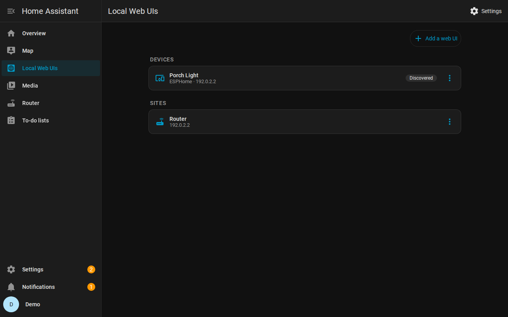
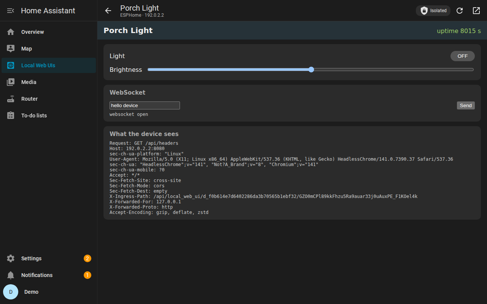
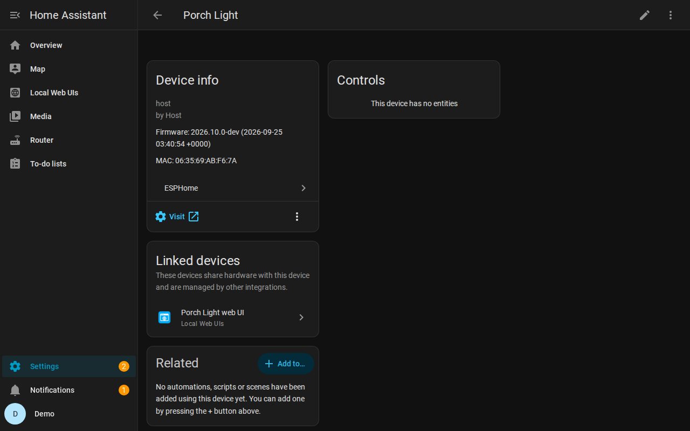

# Local Web UIs for Home Assistant

Open the web UIs of your local devices and sites **inside Home Assistant**: ESPHome's
`web_server`, WLED, printers, routers, NAS dashboards. Home Assistant proxies them, so they
work wherever Home Assistant works:
- away from home, through Nabu Casa or your own reverse proxy;
- over HTTPS, with no mixed-content errors;
- in the companion apps.

You don't need to open ports or change any firmware.

| All your web UIs in one place | A device's own UI, proxied | On the device page |
|---|---|---|
|  |  |  |

## Features

- **One entry per web UI.** Each web UI is an entry of the integration, like the areas of
  Adaptive Lighting or the servers of Matter. Its settings (name, URL, mode, login, icon,
  sidebar entry, Visit link) are under the entry's **Configure** button. A separate
  *Local Web UIs* entry holds the global settings.
- **Discovery.** Devices whose integration links to a local web page (the device page's
  **Visit** button) are offered under *Discovered* on the integrations page, like any other
  discovered device. That covers ESPHome devices with `web_server`, WLED, many printers and
  routers. Choose **Add** to get a web UI for it, or **Ignore** to stop seeing it.
  Discovery can be switched off in the global settings.
- **Your own sites.** Add any page your Home Assistant server can reach under
  *Settings → Devices & services → Local Web UIs → Add entry*. For each one you can set:
  - a name, URL and icon;
  - a stored login, sent as HTTP Basic or Digest auth so you are never prompted;
  - an API token, sent as a Bearer token, in `X-Api-Key`, or in a header you name;
  - who is viewing, as a token Home Assistant signs (see [Who is viewing](#who-is-viewing));
  - who else can open it: users who are not admins (see [Sharing](#sharing-with-users-who-are-not-admins));
  - whether to verify the SSL certificate;
  - its own sidebar entry.
- **Linked devices.** Each device web UI has a device of its own, "*device* web UI". Home
  Assistant shows it in the **Linked devices** card of the device's page, and its Visit
  button opens the web UI here. The device itself is left alone.
- **Device page "Visit" links (optional, on by default).** The **Visit** button of the
  device itself can open its web UI here instead of the LAN address, which fails away from
  home. Switch it globally in the global settings, and per web UI in its settings (follow
  the global setting, always here, or always the device's address). The original links are
  restored when you switch it off or remove the web UI.
- **Standalone pages.** Every web UI has its own address (`/local-web-ui/<id>`), an optional
  sidebar entry, and *open in a new tab* for a full-page view. Each row of the list has
  buttons to open it in a new tab, to its device page and to its settings. A web UI opened from a device
  page has buttons back to that device page (and to its linked device).
- **Your sidebar.** The name and icon of the Local Web UIs entry can be changed, or the
  entry hidden, in the global settings.
- **Dashboard card.** Show a web UI on any dashboard (see [Dashboard card](#dashboard-card)).
- **Isolated by default.** See the next section.

## Isolated and trusted

A web page served from Home Assistant's own address normally has full access to Home
Assistant as you. It can read your login token, change your configuration or unlock your
doors. That's fine for code you trust, but not for a router's admin page or an IoT device's
firmware.

**Isolated** (the default) runs each web UI with an *opaque origin*: the browser treats it as
belonging to no site. The page works normally, but it cannot touch Home Assistant. What the
browser then withholds from the page, Local Web UIs provides:

| | How it works when isolated |
|---|---|
| Logins and cookies | Kept server side per Home Assistant user, so they survive reloads and follow you across devices. The *Forget my saved logins and data* button in a web UI's toolbar logs you out. |
| `localStorage` | Emulated and stored server side per user. |
| `sessionStorage` | Emulated for the current page. |
| `document.cookie` | Emulated, backed by the same cookie store. |
| API calls, WebSockets, live updates | Passed through (CORS is handled for you). |
| IndexedDB | Emulated in memory for the current page: apps that need it work, but what they keep there does not survive a reload. |
| Web workers | Started through a small loader, module workers included. Shared workers, and workers started by a worker, are not available. |
| Offline caches | Not available; pages that check for them fall back. |

**Trusted** runs the page with Home Assistant's own origin, as Supervisor apps (add-ons) do.
Use it only for pages that need a browser feature the emulation doesn't cover (an IndexedDB
or a `sessionStorage` that survives reloads, `window.parent` access), and **only for pages
you fully trust**. The form makes you confirm. Site cookies stay server side in this mode
too, and service workers are refused in both modes.

## Who is viewing

A web UI can be told which Home Assistant user is viewing it, for example so a family site
keeps each person's own state, or so a single sign-on gateway in front of the site lets the
person in. Turn on **Tell the site who is viewing** in the web UI's settings. With every
request, Home Assistant then sends a short-lived token it signs: an OpenID Connect style JWT
(RS256, valid 5 minutes) in the `Authorization` header as a Bearer token, or in a header you
name. The browser never sees it, and a page cannot send one of its own.

The token's claims:

| Claim | Value |
|---|---|
| `iss` | `<Home Assistant URL>/api/local_web_ui/identity` |
| `aud` | the site's address (scheme, host and port), or the audience set in the web UI's settings |
| `sub` | the Home Assistant user id |
| `name` | the user's name |
| `preferred_username` | the username the user logs in with |
| `iat`, `nbf`, `exp` | when it was signed, and 5 minutes later |

Anything else, such as `email`, `groups` or a different `preferred_username`, can be set
per person in the global settings, keyed by Home Assistant username or user id:

```yaml
irenika:
  preferred_username: irena
  email: irena@example.com
  groups: [family]
```

Sites check the token with the keys Home Assistant publishes, without any shared secret:

- discovery: `<Home Assistant URL>/api/local_web_ui/identity/.well-known/openid-configuration`
- keys (JWKS): `<Home Assistant URL>/api/local_web_ui/identity/.well-known/jwks.json`

*Home Assistant URL* is its internal URL, or the address set under *Home Assistant's address
for identity checks* in the global settings if sites reach it at another one. The signing key
is made when first needed and kept in Home Assistant's storage.

**oauth2-proxy** accepts these tokens as they are, so a site behind it opens in Home Assistant
without a second login:

```
--skip-jwt-bearer-tokens=true
--extra-jwt-issuers=https://ha.example.com/api/local_web_ui/identity=https://site.example.com
```

Its `X-Auth-Request-User`, `-Email`, `-Preferred-Username` and `-Groups` then come from the
token's `sub`, `email`, `preferred_username` and `groups`, the same headers a browser login
produces. Without an `email` claim, oauth2-proxy uses `sub` as the email.

## Sharing with users who are not admins

Admins can open every web UI. In a web UI's settings, **Who else can open it** lists the
Home Assistant users who are not admins; the ones you choose can open that web UI too, from
its sidebar entry, the *Local Web UIs* list or a dashboard card. Everything else stays admin
only: the settings, discovery, and the other web UIs.

- Home Assistant checks it on every request, not only when the page opens. Taking someone
  off the list ends their open sessions at once, and a user who stops being an admin keeps
  only what is shared with them.
- They see the web UI's name, icon and area, never its address, device or settings.
- They use it with the login or token stored in its settings, and each has their own cookies
  and saved data, like admins.
- A **trusted** web UI runs with Home Assistant's own origin, so its pages can act in Home
  Assistant as whoever is viewing (with that user's permissions). Share only trusted web UIs
  you trust for each of them.
- Sidebar entries are the same for every user in Home Assistant. A web UI's own sidebar entry
  shows for everyone once it is shared with anyone, and the *Local Web UIs* entry once anything
  is shared; users who may not open a web UI get "This web UI is not available to you". A
  dashboard view or a card, which you can show to some users only, avoids that.

## Dashboard card

`custom:local-web-ui-card` shows one web UI on a dashboard, with its own session, kept alive
while the card is shown, and the same isolation as the panel. Add it from the card picker
(*Local Web UI*), or in YAML:

```yaml
type: custom:local-web-ui-card
view_id: 01JABCDEF...      # the web UI; the card editor offers a list
title: Printer             # optional
aspect_ratio: 75%          # optional: height as a share of the width (or 16:9)
```

In a sections or panel view the card fills the space it is given instead of using
`aspect_ratio`. Users who may not open the web UI see "This web UI is not available to you"
in the card. The card's code is loaded on every page of the frontend while the integration is
set up, so no dashboard resource needs to be added.

## Install

Requires Home Assistant 2026.9 or newer.

1. In HACS: ⋮ → *Custom repositories* → add `https://github.com/ashald/ha-local-web-ui` with
   type *Integration*.
2. Install **Local Web UIs** and restart Home Assistant.
3. *Settings → Devices & services → Add integration → Local Web UIs.* This creates the
   entry for the global settings; add it again for each site of your own.
4. Add the discovered devices you want from *Discovered* on the integrations page.
5. Open **Local Web UIs** in the sidebar. Admins see it always; other users once a web UI is
   shared with them.

**Upgrading from 0.2.** Your web UIs move to entries of their own on the first start, with
their settings, logins and saved site data. Hidden devices become ignored discoveries.

## How it works

```
browser ──HTTPS──► Home Assistant  /api/local_web_ui/<web UI>/<session>/…
                        │  (session checked; target from your config, never from the request)
                        └──HTTP(S)──► device / site on your LAN
```

- The panel asks Home Assistant for a short-lived session (256-bit, expires after 5 minutes
  of inactivity) and opens the web UI in an iframe under that path.
- **Rewriting.** Links, redirects, stylesheets and URLs the page builds at runtime (`fetch`,
  XHR, WebSockets, `EventSource`, history, dynamic `src`/`href`) are rewritten to stay under
  that path.
- **Headers.** The proxy drops headers that would break or leak the session: it replaces
  `Origin`, which device UIs reject as cross-origin, and it keeps `Referer` from carrying
  the session. Your browser's credentials for Home Assistant (cookies, a reverse proxy's
  login) never reach a device, and a device's headers cannot change how the browser treats
  Home Assistant. Pages built for Supervisor ingress get the `X-Ingress-Path` they expect.
- **Streaming.** Downloads, server-sent events and WebSockets are streamed.
- **Discovery filter.** Discovery only picks up addresses on your local network. It never
  picks up loopback, link-local, cloud-metadata, Home Assistant itself or Supervisor's
  internal network. Web UIs you add by hand can point anywhere.

See [docs/DESIGN.md](docs/DESIGN.md) for the details.

## Limitations

- **Sidebar entries are global.** Home Assistant shows a panel to all users or to admins only,
  so the sidebar entry of a web UI shared with some users shows for all of them (see
  [Sharing](#sharing-with-users-who-are-not-admins)).
- **Absolute URLs in JavaScript modules.** Some URLs can't be rewritten, most notably
  root-relative `import "/…"` statements in JavaScript modules. A page that relies on them may
  not load. The same goes for a page that builds URLs from `location.origin` while isolated,
  because an isolated page's origin is `null`. Trusted mode usually fixes the second case.
- **No browser login prompts.** For HTTP Basic or Digest auth, store the login in the web
  UI's settings (its entry's *Configure* button). The browser's own prompt is not used,
  and credentials the browser holds are never sent to devices.
- **Home Assistant's request filter.** Home Assistant rejects URLs that look like attacks
  (`../`, `<script>`, SQL keywords) before they reach the proxy, and logs them, including
  the session path. A few router diagnostic pages can run into this.
- **The device sees the session path.** It arrives in the `X-Ingress-Path` header, so the page
  can build links. The session only grants access to that one web UI, and only for a few
  minutes.

## Possible future work

- **A pluggable transport,** for example tunnelling ESPHome's web server over its native
  API, so it works without a direct network path to the device.

## Relation to ESPHome native API tunnelling

A deeper variant tunnels the web UI over ESPHome's encrypted native API connection instead of
plain LAN HTTP. That removes the need for the device's web server to be reachable on the LAN
at all. It needs changes to ESPHome, aioesphomeapi and Home Assistant core; see
[ashald/esphome@variant-1](https://github.com/ashald/esphome/tree/variant-1/poc). This
integration is designed to become its carrier.

## Related projects

- [hass_ingress](https://github.com/lovelylain/hass_ingress) (custom integration, in the HACS
  default list) proxies URLs you list in YAML at `/api/ingress/<name>/`, each with its own
  sidebar panel. Proxied pages share Home Assistant's origin, so they can act as you.
- [Multi-App Proxy](https://github.com/Pulpyyyy/multiappproxy) and
  [Admin Panels](https://github.com/WilliamFriconneau/ha-admin-panels) are apps (add-ons)
  that proxy several LAN UIs behind one ingress panel, also on Home Assistant's origin.
- Browser-in-the-sidebar apps (Firefox, Chromium) stream a whole remote browser: fully
  isolated, but heavy, and not native on phones.

Local Web UIs differs in three ways: it finds device UIs itself (from the device list),
it isolates each page from Home Assistant by default, and it keeps each site's cookies
separately per user on the server. An app (add-on) alone cannot isolate pages: Supervisor
ingress authenticates with a `SameSite=Strict` cookie that isolated pages never send.

## Development

```bash
python3.14 -m venv .venv && . .venv/bin/activate
pip install pytest-homeassistant-custom-component home-assistant-frontend
pytest                      # unit and integration tests
```

`tests/e2e/` holds an end-to-end setup:
- stand-in device UIs;
- an ESPHome host-platform device;
- `ha_setup.py`, which configures a running Home Assistant;
- `browser_e2e.mjs`, a Playwright run that exercises everything in Chromium.

## License

MIT
